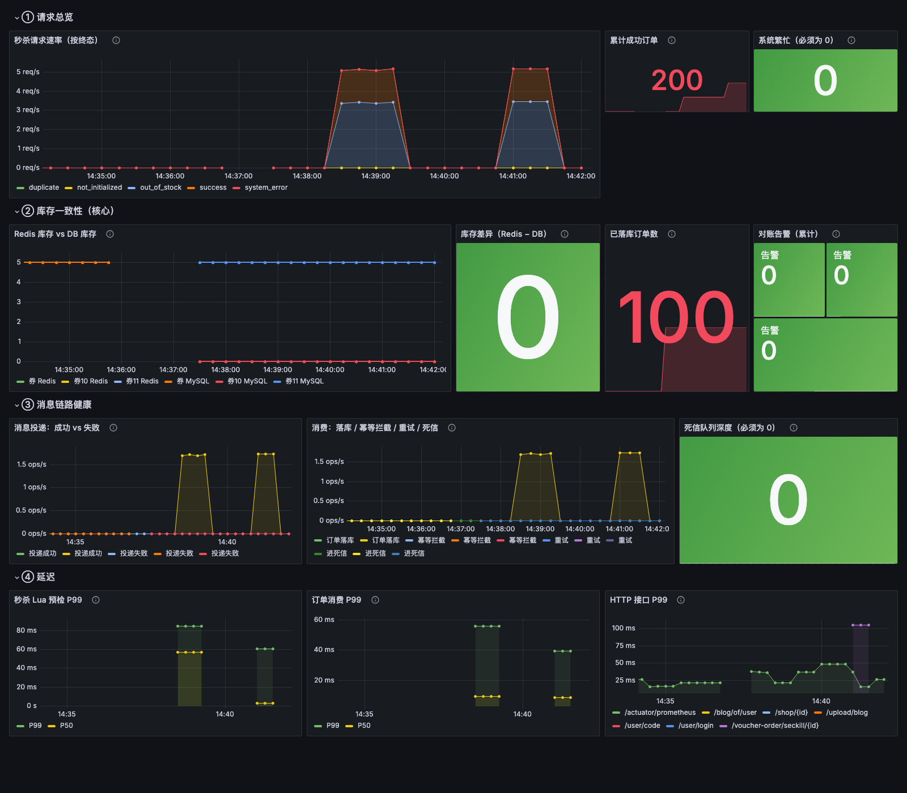

## 项目描述

仿大众点评的本地生活服务平台（Java / Spring Boot），实现了短信登录、商户查询缓存、优惠券秒杀、附近商户、UV 统计、用户签到、好友关注、达人探店等功能。

**项目的核心不在功能数量，而在秒杀链路的可靠性工程。** 高并发下最容易出问题的不是"能不能下单"，而是"会不会超卖、会不会重复下单、消息丢了怎么办、数据漂移了怎么发现"。本项目围绕这些问题做了一整套工程化处理，并用压测与混沌测试验证。

## 秒杀链路做了什么

### 一、正确性

| 问题 | 处理 |
|---|---|
| 超卖 | Redis + Lua 原子预检（库存判断、用户去重、扣减、记录一次完成），DB 侧再用 `stock > 0` 乐观条件兜底 |
| 重复下单 | 两层防护：Redis `HEXISTS` 挡住用户狂点（否则 Redis 库存会被多扣）；DB 唯一索引 `uk_user_voucher` 兜住消息重投与 Redis 丢 key |
| 消费原子性 | `save()` 与扣库存在**同一事务**内，且**先插订单再扣库存**——重复消息先撞唯一索引，此时库存分毫未动 |
| 消息不丢 | 发送端 `publisher-confirm-type: correlated` 同步等 broker 确认；失败则用 Lua 回滚 Redis 扣减（脚本会比对 orderId，避免抹掉有效订单） |
| 消费不重 | 手动 ACK，事务提交后才确认；`DuplicateKeyException` 按幂等成功处理，绝不重试 |

### 二、可靠性

- **三段式 MQ 拓扑**：业务队列（无 TTL、无 DLX）→ 延迟重试队列（TTL 5s，到期 DLX 回业务交换机）→ 死信停车场（无消费者，人工介入）
- **永远不用 `basicNack(requeue=true)`**：它会形成没有延迟、没有上限的热循环，一个毒消息就能把 CPU 和日志打满
- **对账任务**：Redis 有单 DB 无单 → 自动补单；DB 有单 Redis 无记录 → 只告警；库存漂移 → 只在流水线静止时校验并回写
- **缓存预热**：Redis 被清空后 Lua 会一直返回 `-1` 且无法自愈，启动时按 DB 重建缺失的 key

### 三、可观测性

Micrometer + Prometheus + Grafana，把"做对了"变成"看得见"：

- 请求终态分布（成功 / 库存不足 / 重复 / 系统繁忙 / 未初始化）
- **Redis 库存与 DB 库存两条曲线，应当重合**——分叉即意味着数据漂移
- 消息投递、幂等拦截、重试、死信深度
- Lua 预检与订单消费的 P50/P99



### 四、实测数据

`scripts/seckill-loadtest.py`（纯标准库，无需 JMeter），300 并发抢 100 库存：

| 指标 | 结果 |
|---|---|
| QPS / P99 | 1653 / 79.5 ms |
| HTTP 错误 | 0 |
| **超卖数 / 重复单数** | **0 / 0** |
| Redis 与 DB 库存一致性 | ✅ |

**混沌测试**——模拟 Redis 丢 key（删除去重记录并把库存回滚到 100），让同样的 300 个用户重放：

| | 结果 |
|---|---|
| Redis 侧 | 100 个请求通过预检 |
| DB 侧 | **仍然 100 条订单、0 重复、库存 0** |
| 唯一索引拦截 | 97 次 `DuplicateKeyException`，全部幂等 ACK |

旧代码在这个场景下会产生 100 条重复订单 —— 这正是加唯一索引的价值。

## 所用技术

Spring Boot 3.2 · JDK 17 · MySQL 8 · Redis · RabbitMQ · MyBatis-Plus · Redisson · Prometheus · Grafana · Docker Compose

## 快速开始

```bash
# 1. 一键起中间件（MySQL / Redis / RabbitMQ / Prometheus / Grafana）
docker compose up -d

# 2. 启动应用（需 JDK 17）
mvn spring-boot:run

# 3. 访问
#    应用      http://localhost:8081
#    监控大盘   http://localhost:3000/d/hmdp-seckill
#    Prometheus http://localhost:9090
```

构建时若默认 JDK 不是 17，需显式指定：

```bash
JAVA_HOME=/path/to/jdk17 mvn spring-boot:run
```

## 压测

```bash
# 先造秒杀券（或直接用库里已有的）
python3 scripts/seckill-loadtest.py --users 300 --token-file src/test/resources/tokens.txt
```

---

# 项目 亮点难点

## 使用Redis解决了在集群模式下的Session共享问题，使用拦截器实现了用户的登录校验和权限刷新

**为什么用Redis替代Session？**

使用Session时，根据客户端发送的session-id获取Session，再从Session获取数据，由于Session共享问题：多台Tomct并不共享session存储空间，当请求切换到不同tomcat服务时导致数据丢失的问题。

解决方法：用Redis代替Session存储User信息，注册用户时，会生成一个随机的Token作为Key值存放用户到Redis中。 

**还有其他解决方法吗？**

基于 Cookie 的 Token 机制，不再使用服务器端保存 Session，而是通过客户端保存 Token（如 JWT）。
Token 包含用户的认证信息（如用户 ID、权限等），并通过签名验证其完整性和真实性。
每次请求，客户端将 Token 放在 Cookie 或 HTTP 头中发送到服务

**说说你的登录流程？**


使用Redis代替session作为缓存，使用Token作为唯一的key值

**怎么使用拦截器实现这些功能？**


系统中设置了两层拦截器：

第一层拦截器是做全局处理，例如获取Token，查询Redis中的用户信息，刷新Token有效期等通用操作。

第二层拦截器专注于验证用户登录的逻辑，如果路径需要登录，但用户未登录，则直接拦截请求。

**使用两层的原因？**

使用拦截器是因为，多个线程都需要获取用户，在想要方法之前统一做些操作，就需要用拦截器，还可以拦截没用登录的用户，但只有一层拦截器不是拦截所有请求，所有有些请求不会刷新Token时间，我们就需要再加一层拦截器，拦截所有请求，做到一直刷新。

*好处：*

职责分离：这种分层设计让每个拦截器的职责更加单一，代码更加清晰、易于维护

提升性能：如果直接在第一层拦截器处理登录验证，可能会对每个请求都进行不必要的检查。而第二层拦截器仅在“需要登录的路径”中生效，可以避免不必要的性能开销。

灵活性：这种机制方便扩展，不需要修改第一层的全局逻辑。

复用 ThreadLocal 数据：第一层拦截器已经将用户信息保存到 ThreadLocal 中，第二层拦截器可以直接使用这些数据，而不需要重复查询 Redis 或其他数据源。

## 基于Cache Aside模式解决数据库与缓存的一致性问题

**怎么保证缓存更新策略的高一致性需求？**

我们使用的时Redisson实现的读写锁，再读的时候添加共享锁，可以保证读读不互斥，读写互斥。我们更新数据的时候，添加排他锁，他是读写，读读都互斥，这样就能保证在写数据的同时，是不会让其他线程读数据的，避免了脏数据。读方法和写方法是同一把锁。

## 使用 Redis 对高频访问的信息进行缓存，降低了数据库查询的压力,解决了缓存穿透、雪崩、击穿问题

**什么是缓存穿透，怎么解决？**


*定义：* 1.用户请求的id在缓存中不存在。
        2.恶意用户伪造不存在的id发起请求。
     
大量并发去访问一个数据库不存在的数据，由于缓存中没有该数据导致大量并发查询数据库，这个现象叫缓存穿透。
缓存穿透可以造成数据库瞬间压力过大，连接数等资源用完，最终数据库拒绝连接不可用。

*解决方法：*

1.对请求增加校验机制

eg:字段id是长整型，如果发来的不是长整型则直接返回

2.使用布隆过滤器


为了避免缓存穿透我们需要缓存预热将要查询的课程或商品信息的id提前存入布隆过滤器，添加数据时将信息的id也存入过滤器，当去查询一个数据时先在布隆过滤器中找一下如果没有到到就说明不存在，此时直接返回。

3.缓存空值或特殊值（本项目应用）


请求通过了第一步的校验，查询数据库得到的数据不存在，此时我们仍然去缓存数据，缓存一个空值或一个特殊值的数据。
但是要注意：如果缓存了空值或特殊值要设置一个短暂的过期时间。

**什么是缓存雪崩，怎么解决？**


 *定义：* 缓存雪崩是缓存中大量key失效后当高并发到来时导致大量请求到数据库，瞬间耗尽数据库资源，导致数据库无法使用。

造成缓存雪崩问题的原因是是大量key拥有了相同的过期时间，比如对课程信息设置缓存过期时间为10分钟，在大量请求同时查询大量的课程信息时，此时就会有大量的课程存在相同的过期时间，一旦失效将同时失效，造成雪崩问题。

*解决方法：*

1、使用同步锁控制查询数据库的线程

使用同步锁控制查询数据库的线程，只允许有一个线程去查询数据库，查询得到数据后存入缓存。

```java
synchronized(obj){
  //查询数据库
  //存入缓存
}
```

2、对同一类型信息的key设置不同的过期时间

通常对一类信息的key设置的过期时间是相同的，这里可以在原有固定时间的基础上加上一个随机时间使它们的过期时间都不相同。

```java
   //设置过期时间300秒
  redisTemplate.opsForValue().set("course:" + courseId, JSON.toJSONString(coursePublish),300+new Random().nextInt(100), TimeUnit.SECONDS);
```

3、缓存预热

不用等到请求到来再去查询数据库存入缓存，可以提前将数据存入缓存。使用缓存预热机制通常有专门的后台程序去将数据库的数据同步到缓存。

**什么是缓存击穿，怎么解决？**


*定义：* 缓存击穿是指大量并发访问同一个热点数据，当热点数据失效后同时去请求数据库，瞬间耗尽数据库资源，导致数据库无法使用。
比如某手机新品发布，当缓存失效时有大量并发到来导致同时去访问数据库。

*解决方法：* 

1.基于互斥锁解决


互斥锁（时间换空间）

优点：内存占用小，一致性高，实现简单

缺点：性能较低，容易出现死锁

这里使用Redis中的setnx指令实现互斥锁，只有当值不存在时才能进行set操作

锁的有效期更具体业务有关，需要灵活变动，一般锁的有效期是业务处理时长10~20倍

线程获取锁后，还需要查询缓存（也就是所谓的双检），这样才能够真正有效保障缓存不被击穿

2.基于逻辑过期方式


逻辑过期（空间换时间）

优点：性能高

缺点：内存占用较大，容易出现脏读

·注意：逻辑过期一定要先进行数据预热，将我们热点数据加载到缓存中

适用场景

商品详情页、排行榜等热点数据场景。

数据更新频率低，但访问量大的场景。

总结：两者相比较，互斥锁更加易于实现，但是容易发生死锁，且锁导致并行变成串行，导致系统性能下降，逻辑过期实现起来相较复杂，且需要耗费额外的内存，但是通过开启子线程重建缓存，使原来的同步阻塞变成异步，提高系统的响应速度，但是容易出现脏读

**为什么重建子线程,作用是什么？**

开启子线程重建缓存的作用在于提高系统的响应速度，避免因缓存击穿导致的数据库压力过大，同时保障系统在高并发场景下的稳定性，但开启子线程重建缓存可能引入数据不一致（脏读）问题

具体原因：

1. 提高系统响应速度

同步阻塞的缺点： 在缓存失效时，传统方案通常会同步查询数据库更新缓存，这会导致用户请求被阻塞，特别是在高并发环境下可能出现大量线程等待，影响系统响应性能。

子线程重建缓存的优势：

主线程只需返回缓存中的旧数据，避免阻塞用户请求。
重建缓存的任务交由后台线程执行，提高用户体验。

2. 减少数据库压力

缓存击穿问题： 当热点数据过期时，多个线程同时访问数据库，可能导致数据库压力骤增，甚至崩溃。

子线程异步重建缓存：

将数据库查询集中到一个后台线程中执行，避免多个线程同时查询数据库。
即便在缓存击穿的情况下，也不会对数据库造成过大的负载。

3. 提高系统吞吐量

同步更新的瓶颈： 如果所有线程都等待缓存更新完成，系统吞吐量会因阻塞而降低。

异步重建的优化：

主线程可以快速返回旧数据，提升并发处理能力。

数据更新操作与用户请求分离，减少了阻塞等待。

4. 减少热点数据竞争

高并发场景下的竞争： 热点数据被大量请求时，多个线程可能同时触发缓存更新逻辑，产生资源竞争。

单子线程更新的效果：

后台线程独占更新任务，避免多线程竞争更新缓存。

配合分布式锁机制，可以有效减少竞争开销。

5. 提升系统的稳定性

数据库保护：

异步更新缓存，减缓数据库的瞬时高并发压力。

在极端情况下，即使缓存更新失败，系统仍能通过返回旧数据保持基本的服务能力。

熔断机制结合：

子线程的异步更新可以结合熔断、降级等机制，当更新任务失败时，系统可快速响应并记录失败日志以便后续处理。

·适用场景

热点数据： 商品详情页、排行榜等访问量极高的场景。

高并发场景： 秒杀、抢购活动中，需要频繁访问热点数据。

容忍短暂数据不一致的场景： 如排行榜数据的延迟更新对用户体验影响较小。

## 使用 Redis + Lua脚本实现对用户秒杀资格的预检，同时用乐观锁解决秒杀产生的超卖问题

**为什么是要用Redis+Lua？**

Redis执行一条命令的时候是具备原子性的，因为Redis执行命令是单线程的，不存在线程安全的问题，但当执行多条Redis命令时，就不是的了，我们把多条Redis指令放到Lua脚本中，Redis会把Lua脚本作为一个整体执行，保证了原子性，无需加锁，天然互斥。

我使用 Redis + Lua 实现秒杀资格预检，是因为它能在 **一次原子操作中完成库存判断、用户去重、扣减库存、记录订单、发消息**，避免了传统多命令方式的竞态条件。同时，Lua 脚本减少了网络开销，提升了性能，是高并发场景下的最佳实践。

**说说这一套流程？**（就是`seckillVoucher`方法）

先获取用户ID和订单ID，再将优惠券ID，用户ID和订单ID传给Lua脚本执行，进行资格预检，根据 Lua 脚本的返回值（0: 成功，1: 库存不足，2: 重复下单）返回对应的错误信息。将订单信息异步发送到 RabbitMQ 队列，由消费者处理后续逻辑，最后返回订单ID给前端。

**什么是超卖问题，怎么解决？**


超卖问题：并发多线程问题，当线程1查询库存后，判断前，又有别的线程来查询，从而造成判断错误，超卖。

解决方式：

```
悲观锁： 添加同步锁，让线程串行执行
      优点：简单粗暴
      缺点：性能一般
```

```
乐观锁：不加锁，再更新时判断是否有其他线程在修改

      优点：性能好
      缺点：存在成功率低的问题(该项目在超卖问题中，不在需要判断数据查询时前后是否一致，直接判读库存>0;有的项目里不是库存，只能判断数据有没有变化时，还可以用分段锁，将数据分到10个表，同时十个去抢)
```

**说一下乐观锁和悲观锁？**

悲观锁：悲观锁总是假设最坏的情况，认为共享资源每次被访问的时候就会出现问题(比如共享数据被修改)，所以每次在获取资源操作的时候都会上锁，这样其他线程想拿到这个资源就会阻塞直到锁被上一个持有者释放。也就是说，共享资源每次只给一个线程使用，其它线程阻塞，用完后再把资源转让给其它线程。

乐观锁:乐观锁总是假设最好的情况，认为共享资源每次被访问的时候不会出现问题，线程可以不停地执行，无需加锁也无需等待，只是在提交修改的时候去验证对应的资源（也就是数据）是否被其它线程修改了（具体方法可以使用版本号机制或 CAS 算法）。

悲观锁通常多用于写比较多的情况（多写场景，竞争激烈），这样可以避免频繁失败和重试影响性能，悲观锁的开销是固定的。不过，如果乐观锁解决了频繁失败和重试这个问题的话（比如LongAdder），也是可以考虑使用乐观锁的，要视实际情况而定。

乐观锁通常多用于写比较少的情况（多读场景，竞争较少），这样可以避免频繁加锁影响性能。不过，乐观锁主要针对的对象是单个共享变量（参考java.util.concurrent.atomic包下面的原子变量类）。

**你使用的什么？**

使用的是乐观锁CAS算法。CAS是一个原子操作，底层依赖于一条CPU的原子指令。

设计三个参数：

- V:要更新的变量值
- E：预期值
- N：拟入的新值

当且仅当V的值等于E时，CAS通过原子方式用新值N来更新V的值。如果不等，说明已经有其他线程更新了V，则当前线程放弃更新。


从业务的角度看，只要库存数还有，就能执行这个操作，所以where条件设置为stock>0


## 使用Redis分布式锁解决了在集群模式下一人一单的线程安全问题

为了防止批量刷券，添加逻辑：根据优惠券id和用户id查询订单，如果不存在，则创建。

在集群模式下，加锁只是对该JVM给当前这台服务器的请求的加锁，而集群是多台服务器，所以要使用分布式锁，满足集群模式下多进程可见并且互斥的锁。

**Redis分布式锁实现思路？**
我使用的Redisson分布式锁，他能做到可重入，可重试

*可重入*:同一线程可以多次获取同一把锁，可以避免死锁，用hash结构存储。

​           大key是根据业务设置的，小key是线程唯一标识，value值是当前重入次数。


*可重试*：Redisson手动加锁，可以控制锁的失效时间和等待时间，当锁住的一个业务并没有执行完成的时候，Redisson会引入一个Watch Dog看门狗机制。就是说，每隔一段时间就检查当前事务是否还持有锁。如果持有，就增加锁的持有时间。当业务执行完成之后，需要使用释放锁就可以了。还有个好处就是，在`高并发`下，一个业务有可能会执行很快。客户1持有锁的时候，客户2来了以后并不会马上拒绝，他会自旋不断尝试获取锁。如果客户1释放之后，客户2可以立马持有锁，性能也能得到提升。


*主从一致性*：连锁(multiLock)-不再有主从节点，都获取成功才能获取锁成功，有一个节点获取锁不成功就获取锁失败

一个宕机了，还有两个节点存活，锁依旧有效，可用性随节点增多而增强。如果想让可用性更强，也可以给多个节点建立主从关系，做主从同步，但不会有主从一致问题，当新线程来新的主节点获取锁，由于另外两个主节点依然有锁，不会出现锁失效问题吗，所以不会获取成功。


[另一篇文章详细了解Redisson](https://kneegcyao.github.io/2024/12/05/Redisson/)


## 基于stream结构作为消息队列,实现异步秒杀下单

**为什么用异步秒杀?**


我们用jmeter测试，发现高并发下异常率高，吞吐量低，平均耗时高

整个业务流程是串行执行的，查询优惠券，查询订单，减库存，创建订单这四步都是走的数据库，mysql本身并发能力就较少，还有读写操作，还加了分布式锁，整个业务耗时长，并发能力弱。

**怎么进行优化？**


我们分成两个线程，我们将耗时较短的逻辑判断放到Redis中，例如：库存是否充足，是否一人一单这样的操作，只要满足这两条操作，那我们是一定可以下单成功的，不用等数据真的写进数据库，我们直接告诉用户下单成功就好了，将信息引入异步队列记录相关信息，然后后台再开一个线程，后台线程再去慢慢执行队列里的消息，这样我们就能很快的完成下单业务。


- 当用户下单之后，判断库存是否充足，只需要取Redis中根据key找对应的value是否大于0即可，如果不充足，则直接结束。如果充足，则在Redis中判断用户是否可以下单，如果set集合中没有该用户的下单数据，则可以下单，并将userId和优惠券存入到Redis中，并且返回0，整个过程需要保证是原子性的，所以我们要用Lua来操作，同时由于我们需要在Redis中查询优惠券信息，所以在我们新增秒杀优惠券的同时，需要将优惠券信息保存到Redis中
- 完成以上逻辑判断时，我们只需要判断当前Redis中的返回值是否为0，如果是0，则表示可以下单，将信息保存到queue中去，然后返回，开一个线程来异步下单，其阿奴单可以通过返回订单的id来判断是否下单成功

**说说stream类型消息队列？**

使用的是消费者组模式（`Consumer Group`）

- 消费者组(Consumer Group)：将多个消费者划分到一个组中，监听同一个队列，具备以下特点
  1. 消息分流
     - 队列中的消息会分留给组内的不同消费者，而不是重复消费者，从而加快消息处理的速度
  2. 消息标识
     - 消费者会维护一个标识，记录最后一个被处理的消息，哪怕消费者宕机重启，还会从标识之后读取消息，确保每一个消息都会被消费
  3. 消息确认
     - 消费者获取消息后，消息处于pending状态，并存入一个pending-list，当处理完成后，需要通过XACK来确认消息，标记消息为已处理，才会从pending-list中移除

*基本语法：*

- 创建消费者组

  ```java
  XGROUP CREATE key groupName ID [MKSTREAM]
  ```

  - key: 队列名称
  - groupName: 消费者组名称
  - ID: 起始ID标识，$代表队列中的最后一个消息，0代表队列中的第一个消息
  - MKSTREAM: 队列不存在时自动创建队列

- 删除指定的消费者组

  ```bash
  XGROUP DESTORY key groupName
  ```

- 给指定的消费者组添加消费者

  ```bash
  XGROUP CREATECONSUMER key groupName consumerName
  ```

- 删除消费者组中指定的消费者

  ```bash
  XGROUP DELCONSUMER key groupName consumerName
  ```

- 从消费者组中读取消息

  ```bash
  XREADGROUP GROUP group consumer [COUNT count] [BLOCK milliseconds] [NOACK] STREAMS key [keys ...] ID [ID ...]
  ```

  - group: 消费者组名称
  - consumer: 消费者名，如果消费者不存在，会自动创建一个消费者
  - count: 本次查询的最大数量
  - BLOCK milliseconds: 当前没有消息时的最大等待时间
  - NOACK: 无需手动ACK，获取到消息后自动确认（一般不用，我们都是手动确认）
  - STREAMS key: 指定队列名称
  - ID: 获取消息的起始ID
    - `>`：从下一个未消费的消息开始(pending-list中)
    - 其他：根据指定id从pending-list中获取已消费但未确认的消息，例如0，是从pending-list中的第一个消息开始


*基本思路：*

```java
while(true){
    // 尝试监听队列，使用阻塞模式，最大等待时长为2000ms
    Object msg = redis.call("XREADGROUP GROUP g1 c1 COUNT 1 BLOCK 2000 STREAMS s1 >")
    if(msg == null){
        // 没监听到消息，重试
        continue;
    }
    try{
        //处理消息，完成后要手动确认ACK，ACK代码在handleMessage中编写
        handleMessage(msg);
    } catch(Exception e){
        while(true){
            //0表示从pending-list中的第一个消息开始，如果前面都ACK了，那么这里就不会监听到消息
            Object msg = redis.call("XREADGROUP GROUP g1 c1 COUNT 1 STREAMS s1 0");
            if(msg == null){
                //null表示没有异常消息，所有消息均已确认，结束循环
                break;
            }
            try{
                //说明有异常消息，再次处理
                handleMessage(msg);
            } catch(Exception e){
                //再次出现异常，记录日志，继续循环
                log.error("..");
                continue;
            }
        }
    }
}
```
**XREADGROUP命令的特点？**

1. 消息可回溯
2. 可以多消费者争抢消息，加快消费速度
3. 可以阻塞读取
4. 没有消息漏读风险
5. 有消息确认机制，保证消息至少被消费一次

---
# 技术选型说明：使用 RabbitMQ 替换 Redis Stream

## 背景

在项目秒杀异步下单场景中，原方案基于 **Redis Stream** 实现消息队列、异步创建订单。为提升系统可靠性、稳定性与可维护性，**选用 RabbitMQ 替换 Redis Stream**。

## 替换原因

### 1. 消息可靠性更强（核心）

- Redis Stream 依赖 Redis 异步持久化与主从同步，宕机或主从切换存在消息丢失风险。
- RabbitMQ 支持**消息持久化、队列持久化、生产者确认、消费者手动 ACK**，可保证订单消息不丢失，避免库存扣减但未生成订单等资损问题。

### 2. 消息堆积能力更优

- Redis Stream 消息存储在内存，秒杀高并发下易造成内存溢出（OOM）。
- RabbitMQ 消息落盘存储，支持大规模、长时间消息堆积，抗流量峰值能力更强。

### 3. 消费机制更简洁高效

- Redis Stream 需要手动编写轮询拉取逻辑，CPU 占用高、代码冗余。
- RabbitMQ 基于**事件驱动监听模式**，无需轮询，配合 Spring 注解开箱即用，代码更简洁。

### 4. 异常处理更完善

- Redis Stream 需手动维护 Pending 列表、重试、死信逻辑，开发成本高。
- RabbitMQ 原生支持**消费重试、死信交换机、死信队列**，异常消息可统一处理，适合生产级系统。

### 5. 生产级运维与扩展

- RabbitMQ 提供可视化管控台，支持监控队列堆积、消费速率、连接状态。
- 支持灵活的消息路由、延迟队列、集群高可用，更适合分布式系统长期迭代。

## 总结

Redis Stream 适用于轻量、低可靠性、无大量堆积的简单异步场景；  
秒杀订单属于**核心高可靠业务**，**RabbitMQ** 在消息可靠性、堆积能力、异常处理、生产运维上更具优势，更符合线上高并发系统架构要求。

**✅改进：** 使用RabbitMQ更适合。相关面试题可以看这个[相关文章](https://kneegcyao.github.io/posts/93c6a719.html);

---

### ⚠️ 原设计有个致命错误：把 TTL 设在业务队列上

原实现是这样的：

```java
@Bean("queueC")
public Queue queueC(){
    HashMap<String, Object> arguments = new HashMap<>();
    arguments.put("x-message-ttl", 10000);                        // ← 问题在这
    arguments.put("x-dead-letter-exchange", DEAD_LETTER_EXCHANGE);
    arguments.put("x-dead-letter-routing-key", "DLQ");
    return QueueBuilder.durable(QUEUE_C).withArguments(arguments).build();
}
```

当时的理解是：「消息 10 秒还没处理完，就当作失败丢进死信队列重试」。

**这个理解是错的。** `x-message-ttl` 是**队列驻留计时器**，它的语义是「消息在队列的 ready 集合里存活超过 TTL 就变成死信」，**跟消费成功与否毫无关系**：

- 一条消息如果毫秒级就被消费并 ACK，它已经从队列移除了，**永远不会过期**；
- 只有**在 ready 集合里干等了 10 秒**的消息才会被判定为死信 —— 而"干等"意味着消费者停摆或消费慢，不是"处理失败"。

所以这个配置的真实效果是：**业务队列变成一个有损队列，积压超过 10 秒的消息会被静默改道到一个完全不同的处理器**。而那个死信处理器（`receivedD`）里做的是**一模一样**的 `save()` + 扣库存，且它自己连死信配置都没有 —— 消息进去就出不来。

真正导致数据损坏的还有两条：

1. **没有唯一索引兜底**。一人一单的唯一守卫是 Redis 的 `SISMEMBER`。Redis 一旦重启丢 key、内存淘汰或 `FLUSHDB`，守卫就消失了，同一用户会拿到第二条订单 —— 这是必然发生、可稳定复现的。
2. **AUTO ack + `defaultRequeueRejected=true`**。消费者抛异常时 Spring AMQP 默认 `basicNack(requeue=true)`，消息立刻重新投递 → 再抛 → **没有延迟、没有上限的热循环**，一个毒消息就能把 CPU 和日志打满。

---

### 重新设计后的消息链路

```
POST /voucher-order/seckill/{id}
  │
  ├─ 1. orderId = RedisIdWorker.nextId("order")
  ├─ 2. EVALSHA seckill.lua  KEYS=[stock{id}, order{id}]  ARGV=[userId, orderId]
  │         -1 未初始化 | 1 库存不足 | 2 重复下单 | 0 通过
  ├─ 3. convertAndSend(seckill.exchange, seckill.order, json, CorrelationData)
  │         同步等待 broker confirm（≤500ms）
  │         失败 → EVALSHA seckill_rollback.lua 回滚 Redis → 返回"系统繁忙"
  └─ 4. Result.ok(orderId)          ← 请求线程全程不碰 MySQL
        │
        ▼
  seckill.exchange ──seckill.order──▶ seckill.order.queue
        （无 TTL、无 DLX、手动 ACK）        │
                                          ├─ 成功        → basicAck
                                          ├─ DuplicateKey→ basicAck（幂等成功，不重试）
                                          └─ 其他异常    → republish + basicAck
                                                          │
                        retry < 3 ────────────────────────┤
                                                          ▼
  seckill.retry.exchange ──▶ seckill.retry.queue     seckill.dlx.exchange
      （TTL 5s，无人消费，到期 DLX 回业务交换机）              ──▶ seckill.dlq（停车场，无消费者）

  @Scheduled(60s) SeckillReconcileJob
    · 流水线静止时：补 Redis 有单而 DB 缺的订单、校验库存、按需回写 Redis 库存
    · 任何时候：DB 有单而 Redis 无记录 → 告警
    · 死信队列非空 → 告警
```

### 关键设计点（面试可讲）

**1. 业务队列不设任何参数。** 失败走向由消费者**显式决定**，而不是"因为排队久了所以换个人处理"。TTL 只出现在专门的延迟重试队列上 —— 这才是 TTL 的正确用法。

**2. 事务提交之后才 ACK。** 业务方法返回即事务已提交，此时 ACK 才安全。若在事务内 ACK，事务随后回滚就会出现"消息已确认但活没干"——静默丢单。所以 `@Transactional` 必须放在**独立的 service 方法**上，由监听器通过注入的代理调用，而不是直接标在 `@RabbitListener` 方法上。

**3. 永远不用 `basicNack(requeue=true)`。** 重试一律走延迟队列，有延迟、有上限。

**4. 先插订单，再扣库存。** 重复消息会先撞唯一索引 `uk_user_voucher`，此时库存分毫未动；库存耗尽抛异常时，事务回滚会把刚插入的订单一并撤销。两个操作在同一事务里，这是"要么全成、要么全不成"的唯一保证。异常必须在事务方法**之外**捕获，否则不会回滚。

**5. 幂等分两层，各管一件事：**

| 层 | 挡住什么 |
|---|---|
| Redis `HEXISTS`（Lua 内） | 用户狂点按钮。挡不住的话每次重复请求都会扣一次 Redis 库存，DB 唯一索引虽然只放行一条，但**Redis 库存已经被多扣了** |
| DB `UNIQUE (user_id, voucher_id)` | 消息重复投递、Redis 丢 key、broker 重发。这是最终兜底，因为它和业务写入在同一个事务里 |

**6. 发送端同步等 confirm。** `convertAndSend` 默认 fire-and-forget —— 只要 TCP 写成功就返回，broker 是否持久化、消息是否路由到队列，发送方一概不知。开启 `publisher-confirm-type: correlated` 后可以拿到 `CorrelationData` 的 future，把"消息确实落地了"变成可判断的事实。失败则回滚 Redis 扣减（回滚脚本会比对 orderId 才动手，避免抹掉一条其实已投递成功的有效订单）。

**7. 对账是最后一道防线。** 前面几层都在保证"不出错"，对账负责"出错了也能自己发现并修好"。原则是**只做幂等且非破坏性的操作**：Redis 有单 DB 没单 → 自动补单；DB 有单 Redis 没记录 → 只告警不删数据；库存对不上 → 只告警。

> 对账任务有个必须注意的坑：`orderCount` 和 `dbStock` 是两条独立 SQL，各自是一个瞬间的快照。消费进行中时两次读取来自不同时刻，二者必然"看起来"对不上。所以库存校验**必须只在流水线静止时做**（业务队列和重试队列的 ready + unacked 都为 0）。这个误报是压测时实测到的，已修。

**8. 缓存预热 / 灾难恢复。** 秒杀的全部前置状态都在 Redis 里。Redis 一旦重启或被 flush，Lua 会一直返回 `-1`，用户看到"秒杀尚未开始"且**永远不会自愈**。应用启动时按 DB 重建缺失的 key，只补缺失的、绝不覆盖已存在的。

### 压测结果

`scripts/seckill-loadtest.py`（纯标准库，无需 JMeter），300 并发抢 100 库存：

| 指标 | 结果 |
|---|---|
| QPS | 1653 |
| P50 / P95 / P99 | 25.1 / 71.8 / 79.5 ms |
| HTTP 错误 | 0 |
| 成功 / 业务拒绝 | 100 / 200（库存不足） |
| **超卖数** | **0** |
| **重复单数** | **0** |
| Redis 与 DB 库存一致性 | ✅ |
| 对账告警 | 0 |

**混沌测试**——模拟 Redis 丢 key（`DEL seckill:order:{10}` 并把库存回滚到 100），让同样的 300 个用户重放一遍：

| | 结果 |
|---|---|
| Redis 侧 | 100 个请求通过预检（去重记录已被删除） |
| DB 侧 | **仍然 100 条订单、0 重复、库存 0** |
| 唯一索引拦截 | 97 次 `DuplicateKeyException`，全部按幂等成功 ACK |

旧代码在这个场景下会产生 100 条重复订单 —— 这正是加唯一索引的价值。

---

# 可观测性：让"做对了"变成"看得见"

前面的可靠性机制（幂等拦截、消息重试、对账补偿）在代码里做对了，但线上**完全看不见**——
"有没有超卖""消息有没有丢""重试了多少次"都只能翻日志。指标是把它们变成可观测曲线的唯一途径。

## 启动监控栈

```bash
docker compose up -d     # 会一并启动 Prometheus 与 Grafana
```

| 服务 | 地址 |
|---|---|
| Grafana 大盘 | http://localhost:3000/d/hmdp-seckill （免登录） |
| Prometheus | http://localhost:9090 |
| 应用指标端点 | http://localhost:8081/actuator/prometheus |

数据源与大盘都通过 **Grafana provisioning 自动加载**，不需要手工点界面配置。
clone 下来 `docker compose up` 就能看到大盘。

## 大盘的四个分区


### ① 请求总览

按**终态**区分请求速率，而不是只看总量：

| 终态 | 含义 | 期望 |
|---|---|---|
| `success` | 预检通过、消息已投递 | 抢到的量 |
| `out_of_stock` | 库存不足 | 抢购场景下占大头，正常 |
| `duplicate` | 同一用户重复下单 | 少数；突增说明有人在刷 |
| `not_initialized` | Redis 库存 key 不存在 | **应为 0**，非 0 说明缓存被清空且未预热 |
| `system_error` | Lua 异常 / 消息投递失败已回滚 | **必须为 0**，每个都意味着一个用户被错误拒绝 |

用标签而非多个计数器，PromQL 里一次查询就能算出各占比。

### ② 库存一致性（核心）

**Redis 库存与 DB 库存两条曲线应当重合。** 分叉即意味着数据漂移——
Redis 扣了但 DB 没扣，或反之。这是整套可靠性机制最终要守住的不变量。
旁边配一个 `Redis − DB` 的差值面板，非 0 直接标红。

> **一个设计细节**：库存快照只在**流水线静止**时采样（业务队列与重试队列的
> ready + unacked 都为 0）。因为非静止时订单数与库存是两条独立 SQL 读出来的
> 不同瞬间的值，刷进指标会在大盘上产生**假的漂移尖刺**。
> 这个坑在压测时踩过——对账任务误报 `DB_STOCK_DRIFT`。

### ③ 消息链路健康

| 指标 | 意义 |
|---|---|
| 投递成功 / 失败 | 失败意味着 Redis 已扣减但消息没进 broker；代码会回滚，但回滚本身也可能失败，所以要盯住 |
| 订单落库 | 消费者侧的吞吐 |
| **幂等拦截** | 被唯一索引挡下的重复消息。非零说明消息在重复投递——**这是唯一索引在起作用**，属预期；但长期偏高要去查为什么重投 |
| 重试 / 进死信 | 重试是延迟队列在工作；**死信非零说明重试阶梯被击穿，必须告警** |
| 死信队列深度 | 停车场里积压了多少需要人工介入的消息 |

### ④ 延迟

Lua 预检、订单消费、HTTP 接口三组 P50/P99。

- **Lua 预检**是请求线程上唯一的 Redis 往返（库存判断 + 去重 + 扣减 + 记录，
  单次原子操作），它直接决定秒杀接口的响应时间
- **订单消费**包含落库与扣库存事务，这个值升高说明 DB 有压力
- 两者对比可以看出请求线程上还有多少额外开销

## 指标是怎么埋的

集中定义在 `SeckillMetrics`（`com.hmdp.metrics`）。

**为什么集中而非散落各处**：指标名拼错**不会报错**，只会静默地不显示。
集中定义保证"埋点"和"大盘查询"用的是同一份事实源——
这和 `SeckillKeys` 集中管理 Redis key 是同一个理由。

几个实现细节：

- **五个请求终态的计数器在启动时预注册**。否则计数器要等第一次出现该终态才注册，
  导致大盘在启动初期显示"无数据"，而且 `rate()` 在第一个数据点之前算不出来。
- **瞬时值用 Gauge + AtomicLong**，由对账任务周期性刷新。
  Gauge 持有 `AtomicLong` 的引用，所以更新 `AtomicLong` 就等于更新指标，无需重新注册。
- **为延迟指标开启 `percentiles-histogram`**（见 `application.yaml`），
  否则 Grafana 里算不出 P99。

## 压测验证

300 并发抢 100 库存后，Prometheus 里的指标与压测脚本的断言完全吻合：

| 指标 | 值 | 压测脚本的独立断言 |
|---|---|---|
| `success` | 100 | 成功 100 |
| `out_of_stock` | 200 | 业务拒绝 200 |
| `orders_created` | 100 | 已售订单 100 |
| `duplicates` / `dlq` | 0 / 0 | 重复单 0 |
| `stock_redis` / `stock_db` | 0 / 0 | 库存在 DB 与 Redis 都归零 |

两条独立的观测路径（Prometheus 指标 / 脚本直接查 Redis+MySQL）得出同一结论，
说明指标是真实数据而非摆设。

---


## 使用Redis的 ZSet 数据结构实现了点赞排行榜功能,使用Set 集合实现关注、共同关注功能

**什么是ZSet?**

Zset，即有序集合（Sorted Set），是 Redis 提供的一种复杂数据类型。Zset 是 set 的升级版，它在 set 的基础上增加了一个权重参数 score，使得集合中的元素能够按 score 进行有序排列。

在 Zset 中，集合元素的添加、删除和查找的时间复杂度都是 O(1)。这得益于 Redis 使用的是一种叫做跳跃列表（skiplist）的数据结构来实现 Zset。

**为什么使用ZSet数据结构？**

一人只能点一次赞，对于点赞这种高频变化的数据，如果我们使用MySQL是十分不理智的，因为MySQL慢、并且并发请求MySQL会影响其它重要业务，容易影响整个系统的性能，继而降低了用户体验。


Zset 的主要特性包括：

1.  唯一性：和 set 类型一样，Zset 中的元素也是唯一的，也就是说，同一个元素在同一个 Zset 中只能出现一次。 
2.  排序：Zset 中的元素是有序的，它们按照 score 的值从小到大排列。如果多个元素有相同的 score，那么它们会按照字典序进行排序。 
3.  自动更新排序：当你修改 Zset 中的元素的 score 值时，元素的位置会自动按新的 score 值进行调整。


**点赞**

用ZSet中的add方法增添，时间戳作为score（zadd key value score)

用ZSet中的score方法，来判断是否存在

```java
 @Override
    public Result updateLike(Long id){
        //1.获取当前用户
        Long userId = UserHolder.getUser().getId();
        //2.判断当前用户有没有点赞
        String key=BLOG_LIKED_KEY+id;
        Double score = stringRedisTemplate.opsForZSet().score(key, userId.toString());
        if(score==null) {
            //3.如果未点赞，可以点赞
            //3.1.数据库点赞数+1
            boolean isSuccess = update().setSql("liked=liked+1").eq("id", id).update();
            //3.2.保存用户到redis的set集合  zadd key value score
            if(isSuccess){
                stringRedisTemplate.opsForZSet().add(key,userId.toString(),System.currentTimeMillis());
            }
        }else {
            //4.如果已经点赞，取消点赞
            //4.1.数据库点赞数-1
            boolean isSuccess = update().setSql("liked=liked-1").eq("id", id).update();
            if(isSuccess) {
                //4.2.将用户从set集合中移除
                stringRedisTemplate.opsForZSet().remove(key,userId.toString());
            }
        }
        return Result.ok();
    }
```

**共同关注**

通过Set中的intersect方法求两个key的交集

```java
 @Override
    public Result follow(Long followUserId, Boolean isFollow) {
        //获取登录用户
        Long userId = UserHolder.getUser().getId();
        String key = "follows:" + userId;
        //1.判断关注还是取关
        if(isFollow) {
            //2.关注
            Follow follow = new Follow();
            follow.setFollowUserId(followUserId);
            follow.setUserId(userId);
            boolean isSuccess = save(follow);
            if(isSuccess){
                //把关注用户的id，放入redis的set集合 sadd userId followUserId
                stringRedisTemplate.opsForSet().add(key,followUserId.toString());
            }
        }else {
            //3.取关
            boolean isSuccess = remove(new QueryWrapper<Follow>()
                    .eq("user_id", userId)
                    .eq("follow_user_id", followUserId));
            //移除
            if(isSuccess){
                stringRedisTemplate.opsForSet().remove(key,followUserId.toString());
            }
        }
        return Result.ok();
    }

```


```java
@Override
    public Result followCommons(Long id) {
        //获取当前用户
        Long userId = UserHolder.getUser().getId();
        String key = "follows:" + userId;
        //求交集
        String key2 = "follows:" + id;
        Set<String> intersect = stringRedisTemplate.opsForSet().intersect(key, key2);
        if(intersect==null||intersect.isEmpty()){
            return Result.ok(Collections.emptyList());
        }
        //解析出id
        List<Long> ids = intersect.stream().map(Long::valueOf).collect(Collectors.toList());

        //查询用户
        List<UserDTO> userDTOS = userService
                .listByIds(ids).stream()
                .map(user -> BeanUtil.copyProperties(user, UserDTO.class))
                .collect(Collectors.toList());

        return Result.ok(userDTOS);

    }
```
## 附近商铺搜索

我使用的是Redis的GEO数据结构，来存储商户地理座标

**GEO数据结构简介**

- **Redis GEO本质**：底层基于**Sorted Set（有序集合）**实现，存储每个位置的经纬度信息，并支持快速范围查询。
- **核心能力**：
  - **添加位置**：存储商户ID及其经纬度。
  - **计算距离**：获取两个位置间的距离。
  - **范围搜索**：查找某中心点半径范围内的所有商户。
  - **排序**：按距离升序或降序返回结果。

**基本操作**

**1. GEOADD：添加地理位置**

**作用**：将经纬度与成员（如商户ID）关联，存储到GEO集合中。
**语法**：

```bash
GEOADD key 经度1 纬度1 成员1 [经度2 纬度2 成员2 ...]
```

```bash
GEOADD shops:geo 116.397128 39.916527 "shop:1001" 116.405285 39.904987 "shop:1002"
```

**说明**：

- 经纬度范围为：经度（-180 到 180），纬度（-85.05112878 到 85.05112878）。
- 若成员已存在，会更新其经纬度。
- 返回值为成功添加的成员数量（忽略重复成员的更新）。

---

**2. GEOPOS：获取成员坐标**

**作用**：查询指定成员的经纬度。
**语法**：

```bash
GEOPOS key 成员1 [成员2 ...]
```

**示例**：

```bash
GEOPOS shops:geo "shop:1001"
```

**输出**：

```bash
1) 1) "116.39712721109390259"    # 经度
   2) "39.91652652951830512"     # 纬度
```

**说明**：

- 若成员不存在，返回`nil`。
- 返回值为数组格式，顺序与查询成员一致。

---

**3. GEODIST：计算两个成员间的距离**

**作用**：返回两个地理位置之间的距离。
**语法**：

```bash
GEODIST key 成员1 成员2 [单位]
```

**单位参数**：

- `m`（米，默认）、`km`（千米）、`mi`（英里）、`ft`（英尺）。

  **示例**：

```bash
GEODIST shops:geo "shop:1001" "shop:1002" km
```

**输出**：

```bash
"1.6423"  # 单位：千米
```

**说明**：

- 若任一成员不存在，返回`nil`。
- 使用Haversine公式计算球面距离，误差<0.5%。

---

**4. GEORADIUS：根据中心点搜索半径内的成员**

**作用**：以指定经纬度为中心，搜索半径范围内的成员。
**语法**：

```bash
GEORADIUS key 经度 纬度 半径 单位 [WITHDIST] [WITHCOORD] [ASC|DESC] [COUNT 数量]
```

**参数说明**：

- `WITHDIST`：返回成员与中心点的距离。
- `WITHCOORD`：返回成员的经纬度。
- `ASC/DESC`：按距离升序/降序排序（默认升序）。
- `COUNT`：限制返回结果数量。
  **示例**：

```bash
GEORADIUS shops:geo 116.403847 39.915526 5 km WITHDIST ASC COUNT 10
```

**输出**：

```bash
1) 1) "shop:1001"             # 成员
   2) "0.8521"                # 距离（单位：km）
2) 1) "shop:1002"
   2) "1.6423"
```

---

**5. GEORADIUSBYMEMBER：根据成员位置搜索**

**作用**：以某个成员的位置为中心，搜索半径范围内的其他成员。
**语法**：

```bash
GEORADIUSBYMEMBER key 成员 半径 单位 [WITHDIST] [WITHCOORD] [ASC|DESC] [COUNT 数量]
```

**示例**：

```bash
GEORADIUSBYMEMBER shops:geo "shop:1001" 2 km WITHCOORD
```

**输出**：

```bash
1) 1) "shop:1001"             
   2) "0.0000"                # 距离（自身）
   3) 1) "116.39712721109390259" 
      2) "39.91652652951830512"
```


## 用户签到

基于Redis中的BitMap数据结构实现。

- **BitMap概念**

`Bitmap`，即位图，是一串连续的二进制数组（0和1），可以通过偏移量（offset）定位元素。BitMap通过最小的单位bit来进行`0|1`的设置，表示某个元素的值或者状态，时间复杂度为O(1)。我们将签到记录为1，为签到记录为0。

由于 bit 是计算机中最小的单位，使用它进行储存将非常节省空间，特别适合一些数据量大且使用**二值统计的场景**。

`Bitmap` 本身是用 `String` 类型作为底层数据结构实现的一种统计二值状态的数据类型。

`String` 类型是会保存为二进制的字节数组，所以，Redis 就把字节数组的每个 bit 位利用起来，用来表示一个元素的二值状态，你可以把 `Bitmap` 看作是一个 bit 数组。


----

- **基本命令**

 **设置标记**

即 setbit ，主要是指将某个索引，设置为1(设置0表示抹去标记)

```java
@Autowired
private StringRedisTemplate redisTemplate;

/**
 * 设置标记位
 *
 * @param key
 * @param offset
 * @param tag
 * @return
 */
public Boolean mark(String key, long offset, boolean tag) {
    return redisTemplate.opsForValue().setBit(key, offset, tag);
}
}
```

 **判断存在与否**

即 getbit key index ，如果返回1，表示存在否则不存在

```java
/**
 * 判断是否标记过
 *
 * @param key
 * @param offest
 * @return
 */
public Boolean container(String key, long offest) {
    return redisTemplate.opsForValue().getBit(key, offest);
}
```

**计数**

即 bitcount key ，统计和

```java
/**
 * 统计计数
 *
 * @param key
 * @return
 */
public long bitCount(String key) {
    return redisTemplate.execute(new RedisCallback<Long>() {
        @Override
        public Long doInRedis(RedisConnection redisConnection) throws DataAccessException {
            return redisConnection.bitCount(key.getBytes());
        }
    });
}
```

项目中我创建了一个记录签到的表，实现签到接口，将当前用户当天签到信息保存到Redis中


```java
/**
 * 用户签到
 *
 * @return
 */
public Result sign() {
    // 1. 获取当前登录用户的ID（从ThreadLocal中获取用户信息，确保线程安全）
    Long userId = ThreadLocalUtls.getUser().getId();
    
    // 2. 获取当前日期时间（使用系统默认时区）
    LocalDateTime now = LocalDateTime.now();
    
    // 3. 拼接Redis键名：格式为 "sign:用户ID:年月"
    //   示例：用户1001在2023年10月签到 → "sign:1001:202310"
    String keySuffix = now.format(DateTimeFormatter.ofPattern(":yyyyMM"));
    String key = USER_SIGN_KEY + userId + keySuffix;
    
    // 4. 获取今天是本月的第几天（范围1~31）
    int dayOfMonth = now.getDayOfMonth();
    
    // 5. 使用Redis位图记录签到（偏移量从0开始，故需-1）
    stringRedisTemplate.opsForValue().setBit(key, dayOfMonth - 1, true);
    
    // 6. 返回操作成功结果
    return Result.ok();
}
```

```java
/**
 * 记录连续签到的天数
 *
 * @return
 */
@Override
public Result signCount() {
    // 1、获取签到记录
    // 获取当前登录用户
    Long userId = ThreadLocalUtls.getUser().getId();
    // 获取日期
    LocalDateTime now = LocalDateTime.now();
    // 拼接key
    String keySuffix = now.format(DateTimeFormatter.ofPattern(":yyyyMM"));
    String key = USER_SIGN_KEY + userId + keySuffix;
    // 获取今天是本月的第几天
    int dayOfMonth = now.getDayOfMonth();
    // 获取本月截止今天为止的所有的签到记录，返回的是一个十进制的数字 BITFIELD sign:5:202203 GET u14 0
    List<Long> result = stringRedisTemplate.opsForValue().bitField(
            key,
            BitFieldSubCommands.create()
                    .get(BitFieldSubCommands.BitFieldType.unsigned(dayOfMonth)).valueAt(0)
    );
    // 2、判断签到记录是否存在
    if (result == null || result.isEmpty()) {
        // 没有任何签到结果
        return Result.ok(0);
    }
    // 3、获取本月的签到数（List<Long>是因为BitFieldSubCommands是一个子命令，可能存在多个返回结果，这里我们知识使用了Get，
    // 可以明确只有一个返回结果，即为本月的签到数，所以这里就可以直接通过get(0)来获取）
    Long num = result.get(0);
    if (num == null || num == 0) {
        // 二次判断签到结果是否存在，让代码更加健壮
        return Result.ok(0);
    }
    // 4、循环遍历，获取连续签到的天数（从当前天起始）
    int count = 0;
    while (true) {
        // 让这个数字与1做与运算，得到数字的最后一个bit位，并且判断这个bit位是否为0
        if ((num & 1) == 0) {
            // 如果为0，说明未签到，结束
            break;
        } else {
            // 如果不为0，说明已签到，计数器+1
            count++;
        }
        // 把数字右移一位，抛弃最后一个bit位，继续下一个bit位
        num >>>= 1;
    }
    return Result.ok(count);
}
```


## UV统计

UV统计（Unique Visitor Statistics）是用于衡量网站、应用程序或其他在线服务中独立访客数量的关键指标。以下是关于UV统计的详细解析：

**1. UV的定义**

- **核心概念**：UV（Unique Visitor，独立访客）指在一定时间范围内（通常为一天），访问某网站或页面的不同用户数量。同一用户多次访问仅计为1次124。
- **与PV的区别**：
  - **PV（Page View，页面浏览量）**：统计用户每次访问页面的次数，多次刷新页面会累加14。
  - **UV更关注用户身份的唯一性**，而PV反映页面热度

**2.实现方法**

使用**HyperLogLog(HLL)**数据结构

- **原理**：基于概率算法，通过哈希函数估算集合基数（即唯一元素数量），无需存储完整用户数据，极大节省内存。
- **Redis实现**：
  - **内存占用**：单个HLL结构仅需≤16KB，误差率<0.81%，适合高并发场景。
  - **命令示例**：
    - `PFADD key user_id`：添加用户到HLL。
    - `PFCOUNT key`：获取UV估算值

**模拟用户数据**

```java
    /**
     * 测试 HyperLogLog 实现 UV 统计的误差
     */
    @Test
    public void testHyperLogLog() {
        String[] values = new String[1000];
        // 批量保存100w条用户记录，每一批1个记录
        int j = 0;
        for (int i = 0; i < 1000000; i++) {
            j = i % 1000;
            values[j] = "user_" + i;
            if (j == 999) {
                // 发送到Redis
                stringRedisTemplate.opsForHyperLogLog().add("hl2", values);
            }
        }
        // 统计数量
        Long count = stringRedisTemplate.opsForHyperLogLog().size("hl2");
        System.out.println("count = " + count);
    }

```

